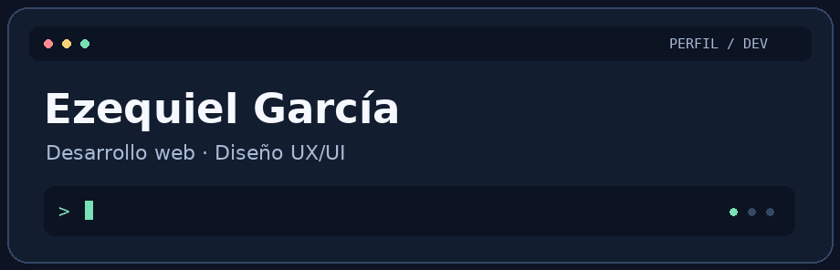

# Hola, soy Ezequiel García 👋

**Desarrollo web y diseño UX/UI**

Me gusta armar productos web y entender cómo funcionan de punta a punta. Disfruto tanto de pensar cómo se usa una interfaz como de resolver qué pasa detrás cuando alguien hace clic, inicia sesión o guarda un dato.

[LinkedIn](https://www.linkedin.com/in/ezequiel-ulises-garcia-b23585266/) · [Behance](https://www.behance.net/ezequielgarcia18)

## Proyecto destacado

**API de productos · Proyecto final de Backend en Talento Tech**

Desarrollé una API REST con Node.js y Express para listar, buscar, crear y eliminar productos. Usé Cloud Firestore para guardar los datos, protegí el alta y el borrado con JWT y probé las rutas con Postman.

Arranqué con un array en memoria y después lo reemplacé por Firestore. Ahí entendí en la práctica dónde usar `await`, cómo manejar los errores de una consulta y qué responsabilidad tiene cada capa de la API.

## Herramientas con las que trabajé

  
  
  
  
  
  
  
  

| Área | Herramientas |
| --- | --- |
| Frontend | HTML, CSS, JavaScript, Bootstrap, Sass y Tailwind CSS |
| Backend | Node.js, Express, Firebase, Cloud Firestore y JWT |
| Mobile | React Native y Redux |
| Diseño | Figma, Photoshop e Illustrator |
| Control de versiones y pruebas de API | Git y Postman |

## Conectemos

Me interesa seguir sumando experiencia en backend y colaborar en proyectos donde el desarrollo y el diseño se complementen. Si querés charlar sobre un proyecto o compartir feedback, escribime por LinkedIn.

[LinkedIn](https://www.linkedin.com/in/ezequiel-ulises-garcia-b23585266/) · [Behance](https://www.behance.net/ezequielgarcia18) · [Instagram](https://www.instagram.com/ezequiel_g789/) · [Facebook](https://www.facebook.com/profile.php?id=100008209728155)
